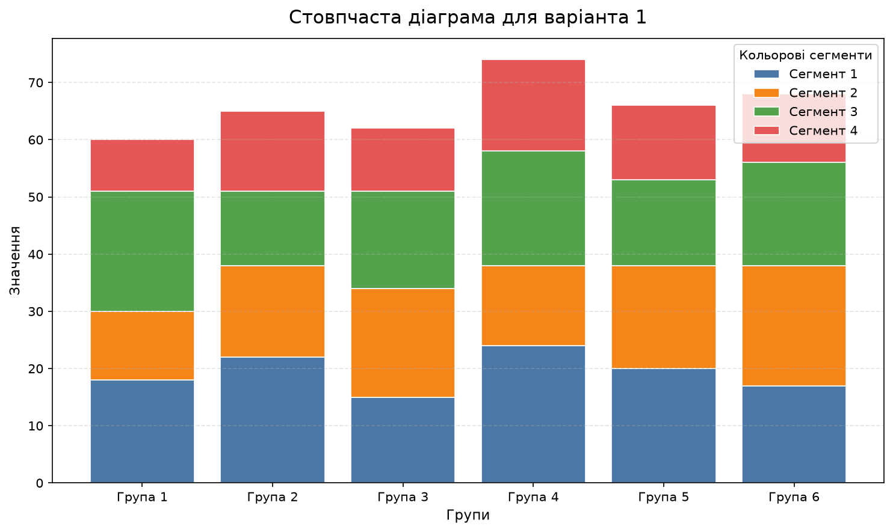
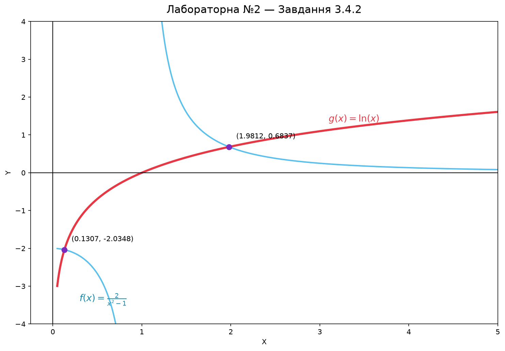

# Applied Mathematics

Three Python labs for variant 1: linear algebra in the console, two-dimensional plotting, and 3D visualization. NumPy, SymPy, and Matplotlib are used where appropriate.

## Results at a glance

The four images below are previews. Open the full galleries: **[all 11 Lab 02 plots](labs/lab02/README.md#gallery)** · **[all 7 Lab 03 plots](labs/lab03/README.md#gallery)**.

| Lab 02 — stacked bar chart | Lab 02 — function intersections |
| --- | --- |
|  |  |

| Lab 03 — six 3D shapes | Lab 03 — surface z = xy |
| --- | --- |
|  |  |

## Labs

| Lab | Work and result |
| --- | --- |
| [01 — Linear and vector algebra](labs/lab01/README.md) | Matrix polynomial and equation, linear system, vector expressions, triangle area, and pyramid volume. Results print to the console; the [report](labs/lab01/Lab1_Report.docx) is included. |
| [02 — 2D plots](labs/lab02/README.md) | Charts, shapes, curves, and function intersections. All 11 plots are visible in the gallery; the [lab report](labs/lab02/Lab2_Report.docx) is included. |
| [03 — 3D plots](labs/lab03/README.md) | Solids, surfaces, 3D bars, and a plot mosaic. All seven plots are visible in the gallery. |

## Run

Use Python 3 from the repository root. Create a virtual environment if desired, then install the [dependencies](requirements.txt):

```bash
python -m pip install -r requirements.txt
```

Run one lab at a time:

```bash
python labs/lab01/main.py
python labs/lab02/main.py
python labs/lab03/main.py
```

Lab 01 prints its answers. Labs 02 and 03 save PNG files under their respective `results/` directories and open Matplotlib windows. Those generated directories are ignored by Git; run the scripts to produce the full sets.
