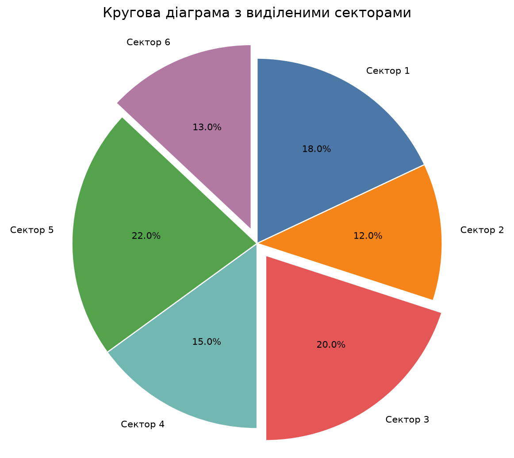
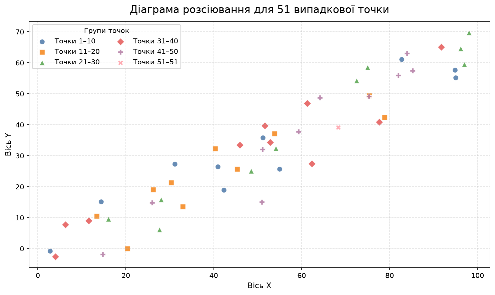
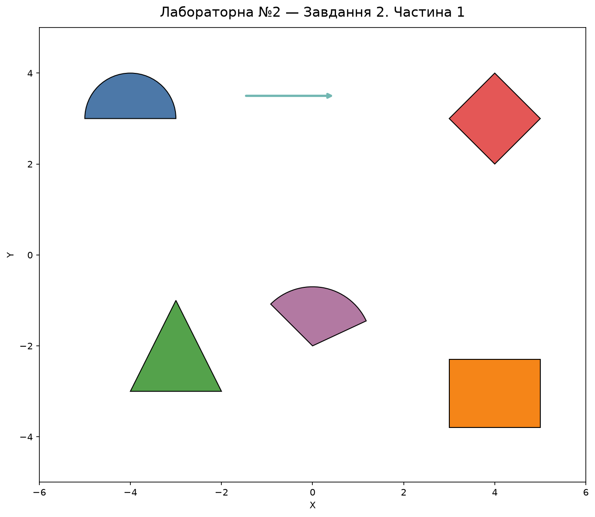
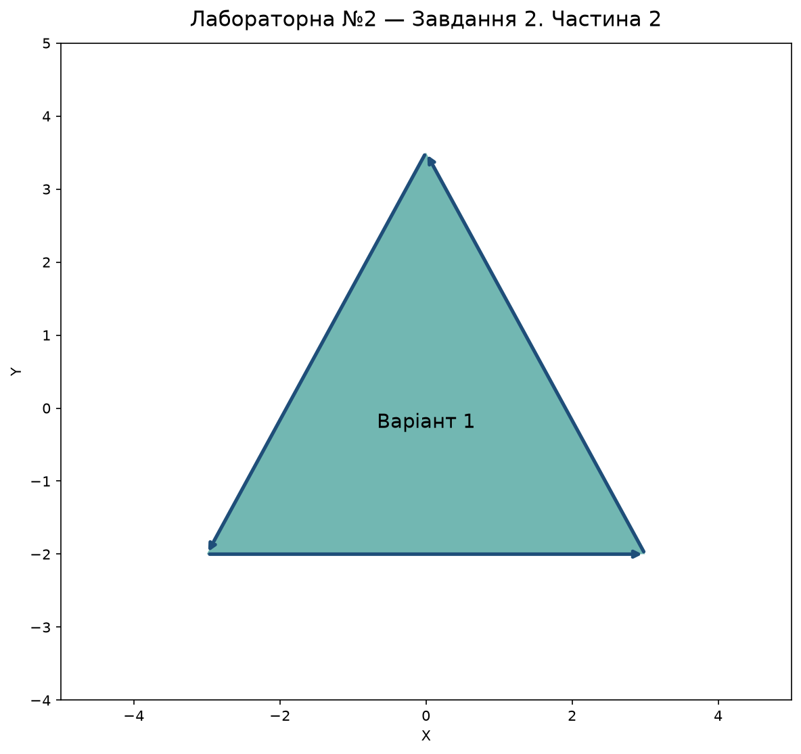
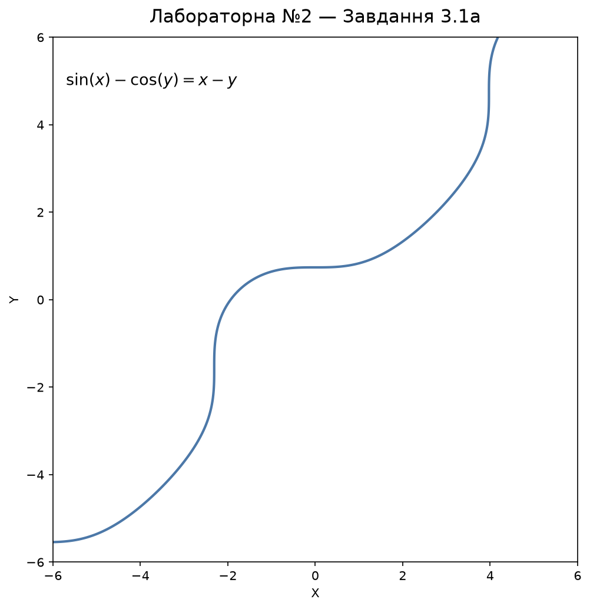
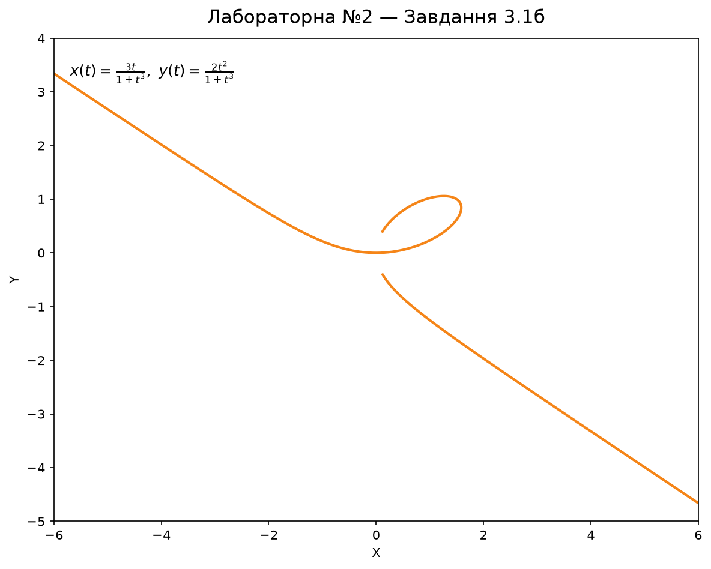
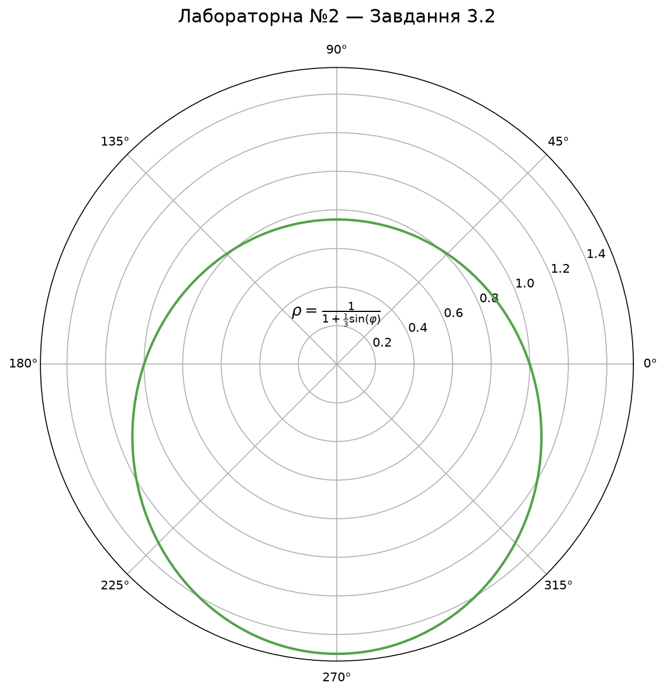
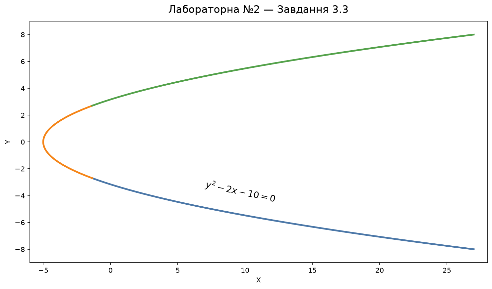
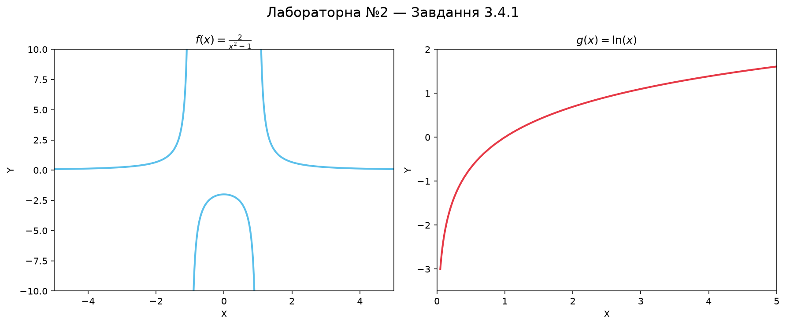

# Lab 02 — 2D Visualization

[The script](main.py) builds 11 Matplotlib figures across three tasks. All 11 outputs are included below. The [lab report](Lab2_Report.docx) is also available.

| Task | Plots saved under `labs/lab02/results/` |
| --- | --- |
| 1 — Charts | `stacked_bar_chart.png` (six groups, four segments each), `pie_chart.png` (six sectors), `scatter_chart.png` (51 points). |
| 2 — Shapes | `task2_primitives.png`, `task2_polygon.png`. |
| 3 — Curves and functions | `task3_implicit_curve.png`, `task3_parametric_curve.png`, `task3_polar_curve.png`, `task3_colored_curve.png`, `task3_functions_subplots.png`, `task3_functions_combined.png`. The last plot marks the intersections also printed in the console. |

After [installing the dependencies](../../README.md#run), run from the repository root:

```bash
python labs/lab02/main.py
```

The script saves the PNG files and opens the figures in Matplotlib windows. The `results/` directory is ignored by Git; selected copies for documentation live in `docs/lab02/`.

## Gallery

### Task 1 — charts





### Task 2 — geometric shapes




### Task 3 — curves and functions







