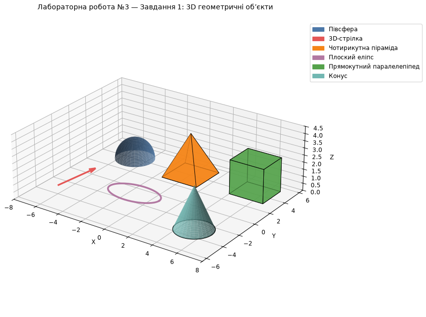
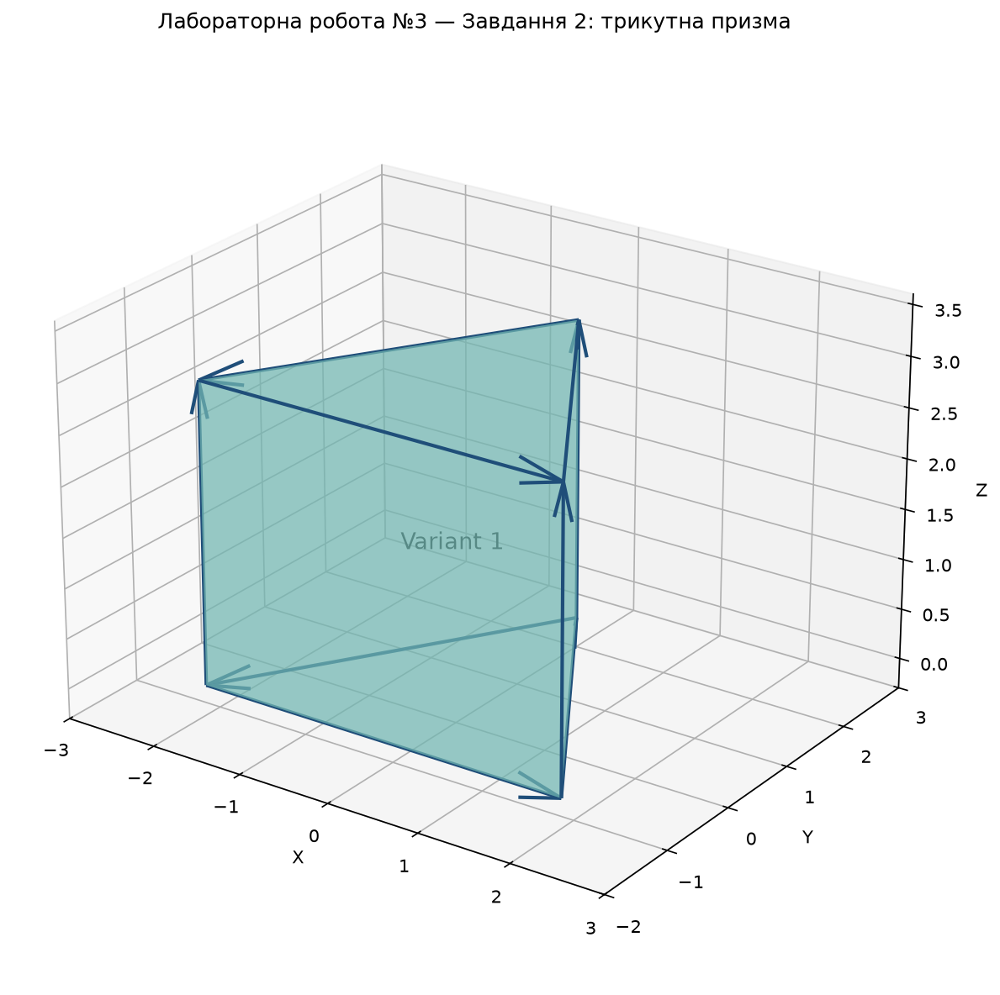
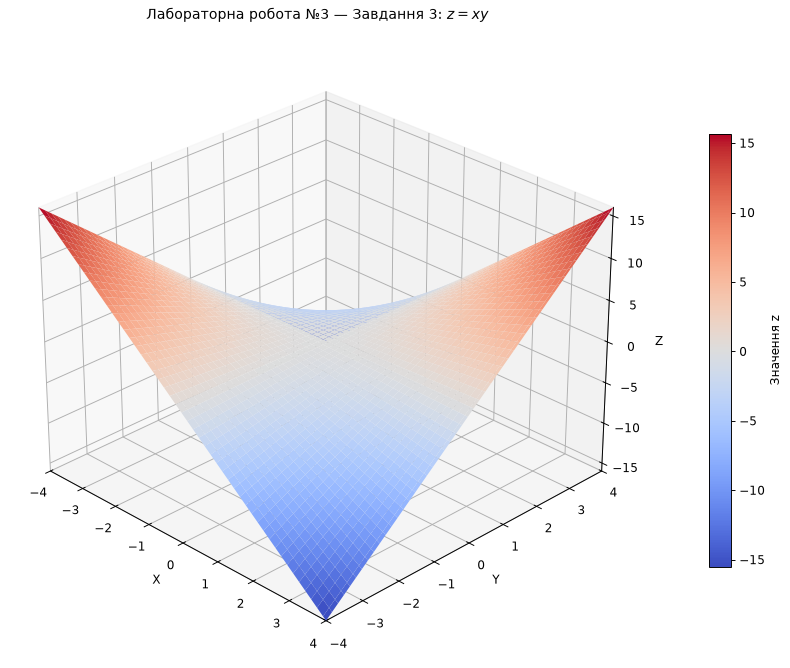
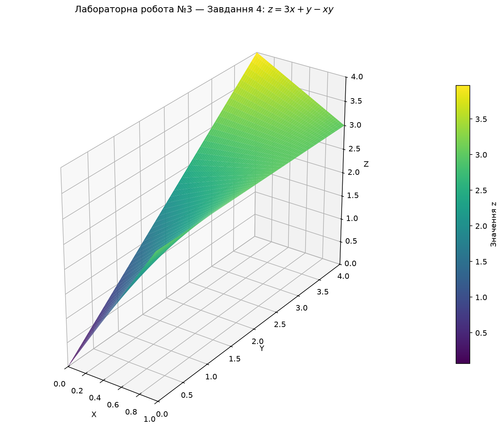
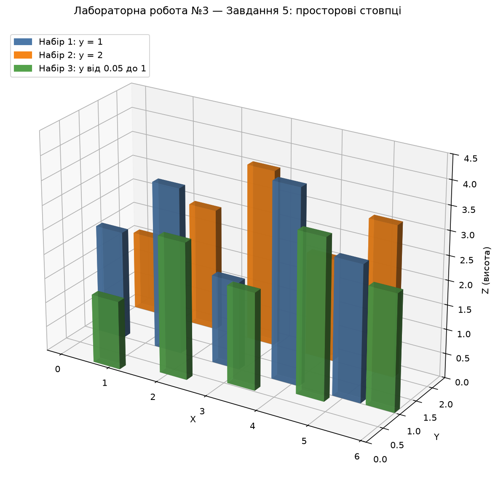
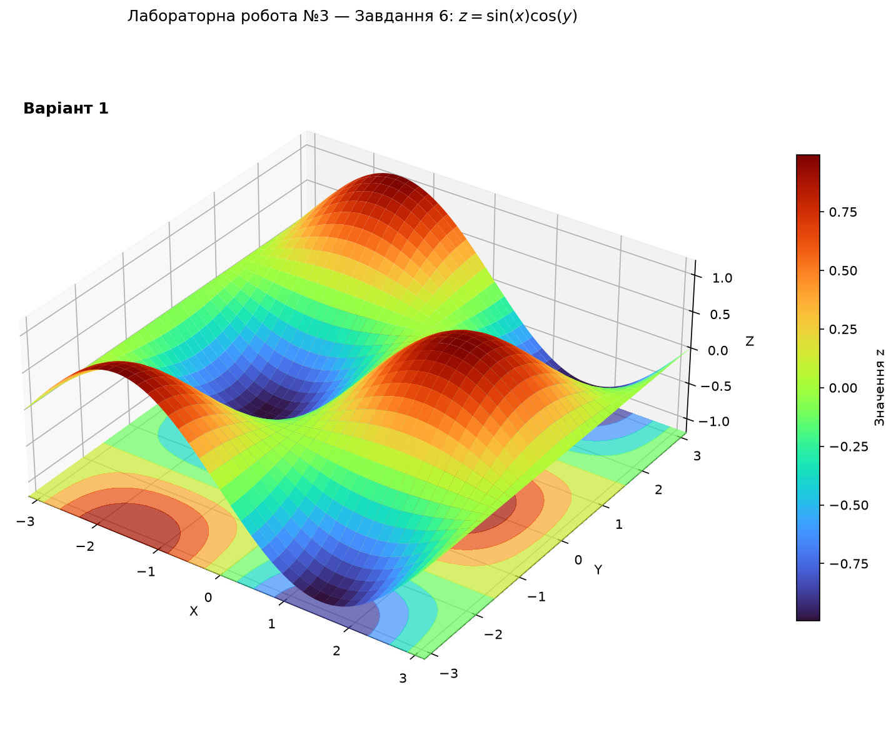
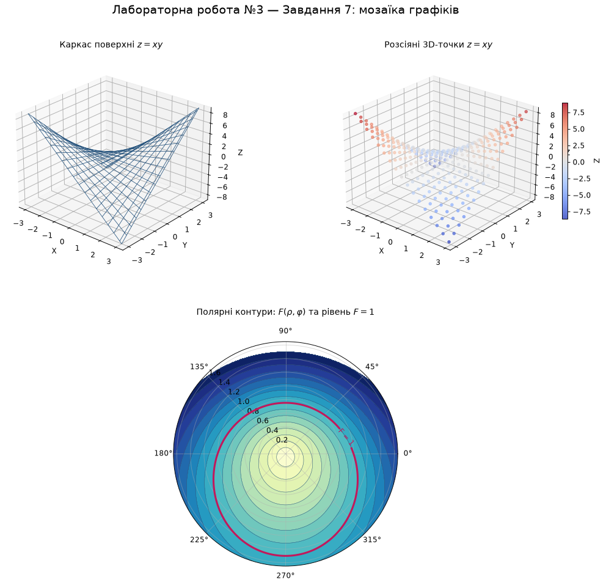

# Lab 03 — 3D Visualization

[The script](main.py) creates seven variant 1 figures with NumPy and Matplotlib. It saves them beside the script in `results/`, which is ignored by Git. Documentation copies of all seven are tracked in `docs/lab03/`.

| Task | Figure | Local output after running |
| --- | --- | --- |
| 1 | Hemisphere, arrow, pyramid, ellipse, parallelepiped, and cone | `task1_3d_shapes.png` |
| 2 | Triangular prism with arrow edges | `task2_3d_prism.png` |
| 3 | Surface `z = xy` | `task3_surface.png` |
| 4 | Surface `z = 3x + y - xy` over `0 ≤ x ≤ 1`, `0 ≤ y ≤ 4` | `task4_colored_surface.png` |
| 5 | Three groups of 3D bars with heights defined in the script | `task5_3d_bars.png` |
| 6 | Surface `z = sin(x) cos(y)` with projected contours | `task6_custom_surface.png` |
| 7 | Mosaic of `z = xy` wireframe and points with polar contours | `task7_mosaic.png` |

## Gallery

Task 1 — six geometric objects:



Task 2 — triangular prism:



Task 3 — the saddle surface `z = xy`:



Task 4 — colored surface:



Task 5 — 3D bars:



Task 6 — wave surface:



Task 7 — a mosaic of plots:



## Run

After [installing the dependencies](../../README.md#run), run from the repository root:

```bash
python labs/lab03/main.py
```

The script saves all seven PNG files and opens the figures. For a machine without a display, set `MPLBACKEND=Agg` before running it.
