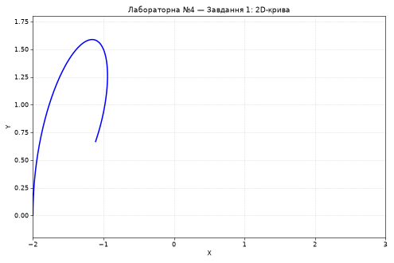
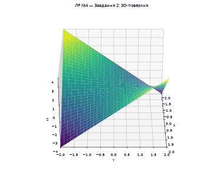
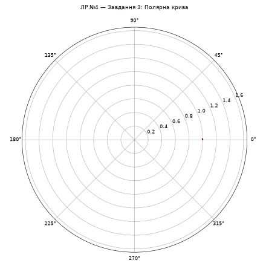

# Lab 04 — Animation

Three Matplotlib animations for variant 1, built with `FuncAnimation`. [`main.py`](main.py) runs one task at a time; the [report](Lab04_Report.docx) is included (in Ukrainian).

| Task | Animation | Preview |
| --- | --- | --- |
| [1 — 2D curve](task1.py) | The parametric curve `x = 2t² / (1 + t³)`, `y = 3t / (1 + t³)` for `t` in [0, 2] slides between the left and right edges of the axes and back, changing color every 40 frames (blue, red, green, purple) in a 160-frame cycle. |  |
| [2 — 3D surface](task2.py) | The saddle surface `z = x · y` on [−2, 2]² stays fixed while the camera azimuth turns around it at a constant elevation of 30°. |  |
| [3 — Polar curve](task3.py) | The curve `ρ = 1 / (1 + sin φ / 3)` is drawn point by point over 180 frames, then rotates around the pole. |  |

The previews are rendered from each task's own `build_figure` and `update` functions with the non-interactive Agg backend. They use fewer frames than the live window (for the surface, one frame every 6° instead of every 1°), so they look coarser and faster than the real animation.

## Run

After [installing the dependencies](../../README.md#run), run from the repository root:

```bash
python labs/lab04/main.py task1
python labs/lab04/main.py task2
python labs/lab04/main.py task3
```

Each task file can also be run directly, for example `python labs/lab04/task1.py`. The animations open in an interactive Matplotlib window, so a desktop display is required. On Windows PowerShell with a virtual environment, use `.\.venv\Scripts\python.exe` in place of `python`.
